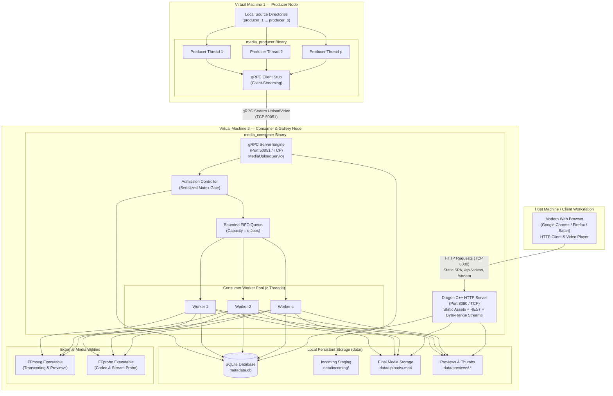
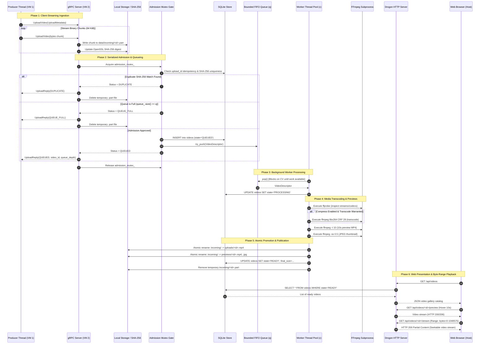
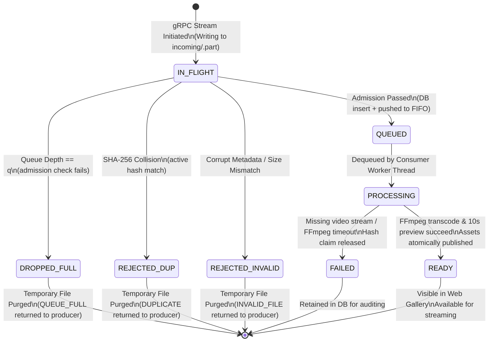
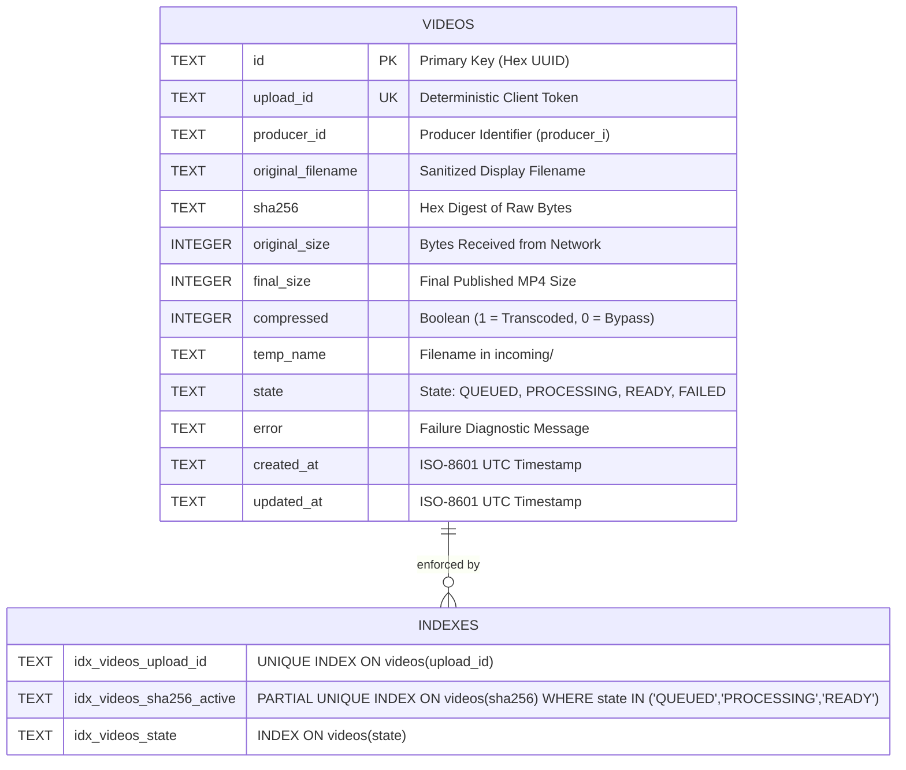
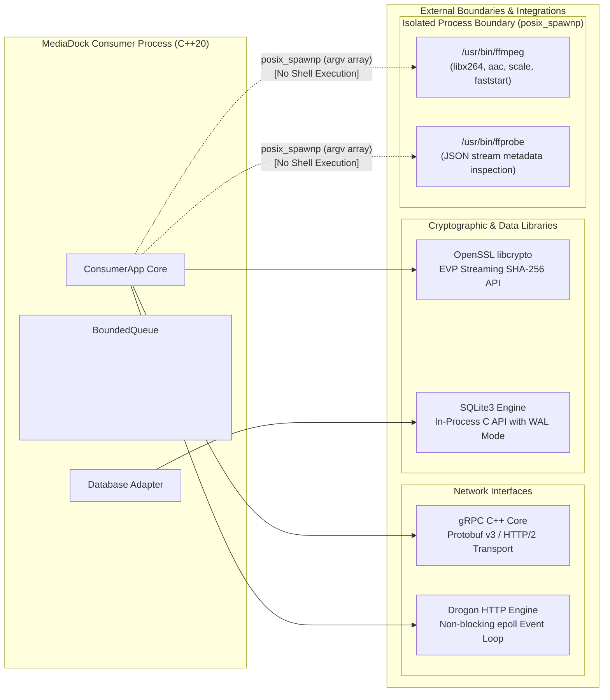

# MediaDock — System Architecture & Design Specification

This document provides a comprehensive technical breakdown of the **MediaDock** architecture, detailing system components, network topologies, concurrency models, data flows, database schemas, and service boundaries.

---

## 1. High-Level System Architecture & Topology

MediaDock operates across two dedicated Linux Virtual Machines (VMs) connected via an isolated private network, serving an interactive web interface to client browsers.



---

## 2. Frontend-to-Backend Data Flow

The ingestion, processing, and playback lifecycle transitions through six coordinated stages:



---

## 3. Upload State Machine & Lifecycle

Every video uploaded to MediaDock undergoes deterministic state transitions managed by strict SQLite transactional invariants:



---

## 4. Database Schema & Entity Relationships

MediaDock uses an embedded SQLite database (`metadata.db`) optimized with Write-Ahead Logging (WAL) and partial indexes for high-throughput concurrent reads and writes.



### Schema Definition (DDL)
```sql
CREATE TABLE IF NOT EXISTS videos (
  id TEXT PRIMARY KEY,
  upload_id TEXT UNIQUE NOT NULL,
  producer_id TEXT NOT NULL,
  original_filename TEXT NOT NULL,
  sha256 TEXT NOT NULL,
  original_size INTEGER NOT NULL,
  final_size INTEGER DEFAULT 0,
  compressed INTEGER DEFAULT 0,
  temp_name TEXT NOT NULL,
  state TEXT NOT NULL,
  error TEXT DEFAULT '',
  created_at TEXT NOT NULL,
  updated_at TEXT NOT NULL
);

-- Partial index: only active records enforce SHA-256 uniqueness.
-- If a job transitions to FAILED, its hash is automatically released.
CREATE UNIQUE INDEX IF NOT EXISTS idx_videos_sha256_active
ON videos(sha256)
WHERE state IN ('QUEUED', 'PROCESSING', 'READY');

CREATE INDEX IF NOT EXISTS idx_videos_state ON videos(state);
```

---

## 5. Third-Party Service Boundaries & Subprocess Isolation

MediaDock strictly isolates core daemon logic from third-party libraries and external command-line utilities:



---

## 6. Concurrency Control & Synchronization Invariants

The architecture enforces strict synchronization guarantees to eliminate race conditions, deadlocks, and memory starvation:

1. **`admission_mutex_`:** Serializes admission verification across all incoming gRPC streams. Under this mutex, the system checks idempotency, validates SHA-256 uniqueness, verifies `queue_.has_room()`, writes the `QUEUED` record to SQLite, and pushes to the queue.
2. **`BoundedQueue` Condition Variable:** Thread-safe FIFO bounded by `q`. Pop operations wait on `std::condition_variable` without spinning. Push operations drop new arrivals if capacity is reached.
3. **`upload_slots_` Counting Semaphore:** Limits maximum concurrent in-flight gRPC streams (`--max-inflight`, default 8), rejecting excess connections with `SERVER_BUSY` before disk writes begin.
4. **Subprocess Isolation via `posix_spawnp`:** FFmpeg and ffprobe run in separate process address spaces. If an FFmpeg instance encounters a segmentation fault or memory leak due to malformed video bitstreams, the consumer daemon remains completely unaffected.
